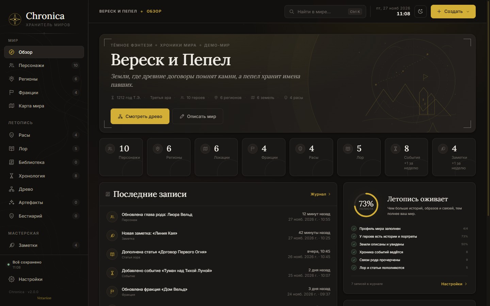
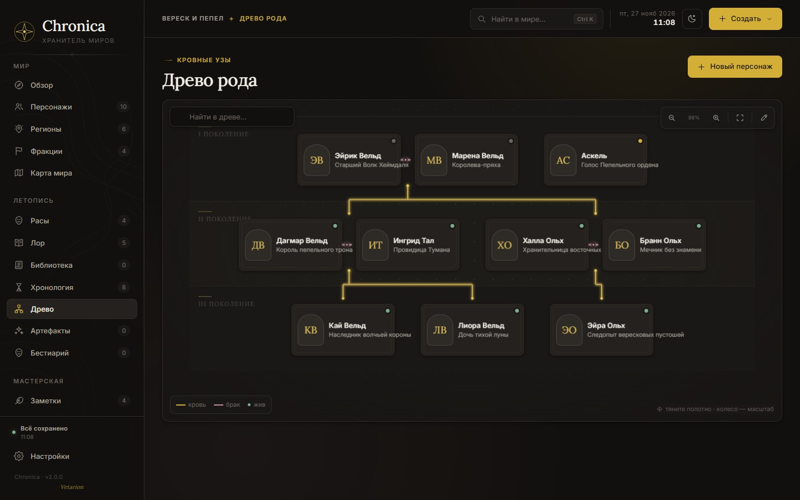
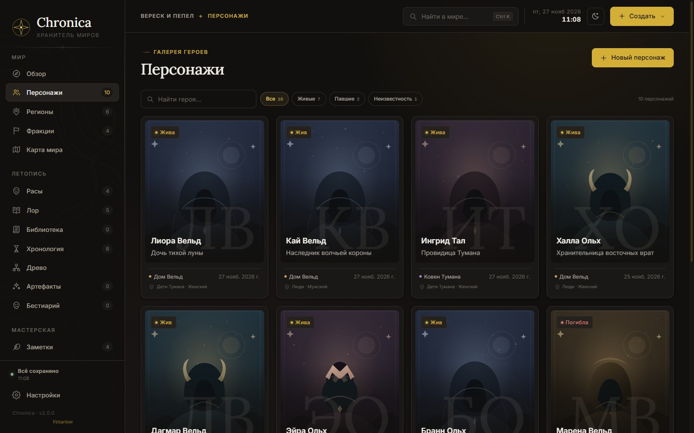
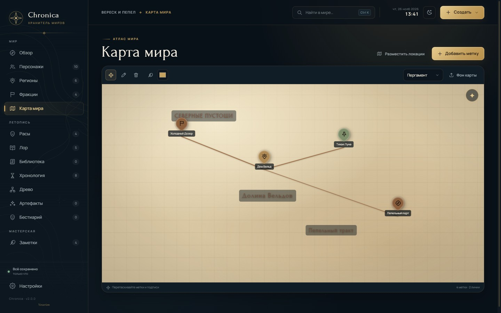

<div align="center">
  
  <h1>Chronica</h1>
  <p><strong>Тихая мастерская для больших историй.</strong></p>
  <p>Миры, герои, древо рода, карта и летопись — в одном локальном приложении для Windows.</p>

  [](https://github.com/IvanSemenovVetarion/Chronica/releases)
  [](#требования)
  [](LICENSE)
  [](https://ivansemenovvetarion.github.io/Chronica/)
</div>



## О проекте

**Chronica 2.0** — настольная мастерская для фэнтезийных миров, героев и
летописей. Она не требует аккаунта, подписки и облака: данные лежат в обычной
папке на вашем компьютере. При желании их можно синхронизировать через общую
папку Яндекс Диска, Google Drive, OneDrive или сетевую папку.

В этом релизе — **классическая Chronica**. Это спокойный инструмент для автора:
открыть мир, записать героя, связать род, нарисовать карту и сохранить всё
в Word, Excel, JSON или ZIP-архив.

- **Сайт проекта:** <https://ivansemenovvetarion.github.io/Chronica/>
- **Полное руководство:** [`README.txt`](README.txt)
- **Исходный код:** <https://github.com/IvanSemenovVetarion/Chronica>


## Скачать

| Файл | Для чего |
|---|---|
| [**ChronicaSetup.exe**](https://github.com/IvanSemenovVetarion/Chronica/releases/latest/download/ChronicaSetup.exe) | Установщик для Windows 10/11 x64. Создаёт ярлыки и запись в «Приложениях». |
| [**Chronica-portable.zip**](https://github.com/IvanSemenovVetarion/Chronica/releases/latest/download/Chronica-portable.zip) | Портативная версия. Распакуйте и запустите `Chronica.exe`. |
| [Все релизы](https://github.com/IvanSemenovVetarion/Chronica/releases) | История версий и заметки к обновлениям. |

После установки Chronica проверяет обновления через GitHub Releases. Если
адрес репозитория в настройках отличается от вашего, укажите его на странице
**Настройки → Обновления**.

### Требования

- Windows 10 или Windows 11, **x64**;
- .NET Framework 4.8 — встроен в Windows 10/11;
- Microsoft Edge WebView2 Runtime — обычно уже установлен.

Если интерфейс не открывается, установите
[WebView2 Runtime](https://go.microsoft.com/fwlink/p/?LinkId=2124703).

## Возможности

### Мир и герои

- Регионы и вложенные локации;
- фракции с лидерами и участниками;
- расы, черты и представители;
- персонажи с историей, характером, внешностью и цитатой;
- большие портреты, галерея до 24 изображений и палитра образа;
- голос и музыка персонажа: до 12 аудиофайлов;
- свои поля в карточке героя — запах, цветок, талисман, любимый напиток.

### Связи и структура

- Генеалогическое древо с ручным перетаскиванием;
- читаемые связи, поколения и роли;
- двусторонние отношения в карточках персонажей;
- карта мира с метками, подписями, маршрутами, реками и фонами;
- своя карта-изображение;
- лор, библиотека-источники и хронология;
- заметки, журнал и прогресс мира.

### Вид и характер

- 10 жанров: фэнтези, D&D, средневековье, фантастика, тёмное фэнтези,
  восточные миры, стимпанк, постапокалипсис, мифы и городское фэнтези;
- 25 палитр и 15 узоров фона;
- масштаб интерфейса 70–160%;
- свои шрифты, фон приложения и иконки разделов;
- русский и английский язык;
- меню под жанр: скрытие пунктов, свои разделы и сброс к набору жанра.

### Данные и работа

- локальное хранение в `ChronicaData`;
- автоматические резервные копии;
- экспорт в Word, Excel и JSON;
- ZIP-архив со всеми изображениями, аудио и шрифтами;
- совместная работа через общую папку облака или сети;
- импорт старых чатов через DeepSeek;
- проверка обновлений через GitHub Releases.

## Скриншоты

<details>
<summary>Показать интерфейс</summary>

### Древо рода



### Галерея героев



### Карта мира



</details>

## Быстрый старт

### Установка

1. Скачайте `ChronicaSetup.exe` из раздела Releases.
2. Запустите установщик и выберите папку.
3. При первом запуске выберите язык, жанр и стиль.
4. Начните свою летопись.

Установщик не требует прав администратора и создаёт ярлыки в меню «Пуск» и на
рабочем столе.

### Портативная версия

1. Распакуйте `Chronica-portable.zip` в любую папку.
2. Запустите `Chronica.exe`.
3. Рядом появятся файлы `WebView2Loader.dll`, `Microsoft.Web.WebView2.Core.dll`
   и `Microsoft.Web.WebView2.WinForms.dll` — они уже в архиве.

Данные будут созданы в папке `ChronicaData` рядом с программой.

## Где хранятся данные

```
<папка установки>\ChronicaData
```

В портативной версии — рядом с `Chronica.exe`. Если папка недоступна для
записи, используется:

```
%LocalAppData%\Chronica
```

Внутри:

- `chronica.json` — миры, герои и летопись;
- `chronica.json.bak` — последняя рабочая копия;
- `images\` — портреты и иллюстрации;
- `audio\` — голос и музыка;
- `fonts\` — свои шрифты;
- `backups\` — ZIP-копии;
- `chronica.log` — журнал работы;
- `settings.json` — тема, язык, синхронизация и ключ DeepSeek.

> Для переноса всех миров скопируйте папку `ChronicaData` целиком.

## Сборка из исходников

Нужны Windows 10/11 x64 и .NET Framework 4.8. Компилятор `csc.exe` уже входит
в Windows. WebView2 DLL лежат в `vendor/`.

```bat
build.cmd
```

Результат:

- `dist\Chronica\Chronica.exe` — приложение;
- `dist\ChronicaSetup.exe` — установщик;
- `dist\Chronica-portable.zip` — портативная версия.

`build/`, `dist/`, `backups/` и пользовательские папки данных исключены из Git.
Сборка не требует npm, Node.js или Visual Studio.

## Структура проекта

```
src/            C#: запуск, окно, мост JavaScript ↔ C#, экспорт, обновления
installer/      установщик и деинсталлятор
ui/             интерфейс: HTML, CSS, JavaScript, шрифты и изображения
vendor/         WebView2 SDK
docs/           страница проекта для GitHub Pages
licenses/       тексты сторонних лицензий
build.cmd       сборка приложения и установщика
README.txt      подробное руководство пользователя
```


## Лицензия и сторонние компоненты

Оригинальный код и материалы Chronica распространяются по лицензии
[**MIT**](LICENSE). Это значит, что код можно изучать, изменять и
распространять при сохранении уведомления об авторстве. Программа
предоставляется «как есть», без гарантий.

Товарные знаки, шрифты и WebView2 **не входят** в лицензию MIT:

- [Сторонние компоненты и уведомления](THIRD_PARTY_NOTICES.md);
- [Лицензия шрифтов OFL 1.1](licenses/OFL-1.1.txt);
- [Условия WebView2 SDK](licenses/webview2/LICENSE.txt);
- [Название и логотип Chronica](TRADEMARKS.md).

## Автор

**Vetarion** · [GitHub](https://github.com/IvanSemenovVetarion)

Сделано с любовью для [@Titzero](https://vk.ru/titzero).

---

## English overview

**Chronica** is a local-first worldbuilding and campaign-planning desktop app
for Windows. It keeps worlds, characters, family trees, maps, lore and notes in
a plain `ChronicaData` folder — no account, no subscription, no cloud by
default.

- Windows 10/11 x64, .NET Framework 4.8 and WebView2 Runtime.
- Download the installer or portable ZIP from
  [Releases](https://github.com/IvanSemenovVetarion/Chronica/releases).
- Source code is licensed under the [MIT License](LICENSE); third-party
  components and trademarks are listed in
  [THIRD_PARTY_NOTICES.md](THIRD_PARTY_NOTICES.md).
